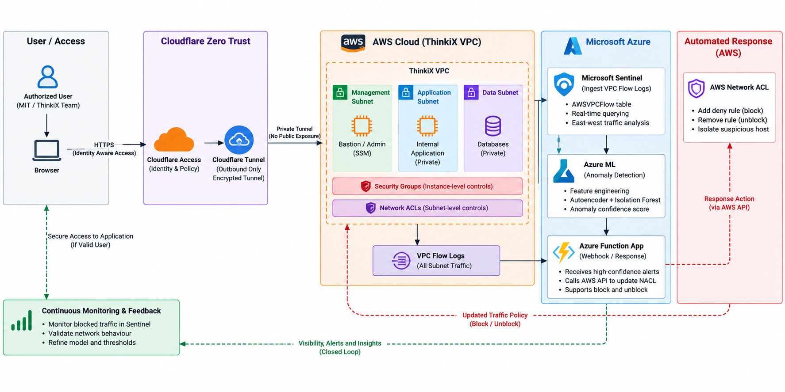

# Secure Cloud Access and Network Segmentation for a Hybrid Enterprise

ThinkiX is a cloud security engineering project that demonstrates how a hybrid enterprise environment can be protected using **Zero Trust access controls, cloud network segmentation, centralized security monitoring, machine-learning-based anomaly detection, and controlled automated response**.

The project brings together AWS and Azure services with Cloudflare to create a layered security architecture in which access is explicitly verified, workloads are segmented, cloud activity is monitored, abnormal network behaviour is analysed, and selected security responses can be enforced through cloud-native controls.

Rather than being a standalone machine-learning experiment or a basic cloud deployment, ThinkiX connects identity, networking, monitoring, detection and response into a single security workflow.

---

## What ThinkiX Demonstrates

The project focuses on a practical hybrid-cloud security workflow built across multiple cloud and security layers.

The main components are:

- **Cloudflare Access** — identity-aware application access
- **Cloudflare Tunnel** — protected application connectivity
- **AWS VPC** — segmented enterprise workload environment
- **AWS IAM / Systems Manager** — identity-based administration
- **AWS Security Groups and Network ACLs** — network-level enforcement
- **AWS CloudTrail / VPC Flow Logs** — cloud and network telemetry
- **Microsoft Sentinel** — centralized security monitoring and investigation
- **Azure Functions** — serverless anomaly-scoring workflow
- **Azure Blob Storage** — machine-learning model artefact storage
- **Autoencoder + Isolation Forest** — behavioural anomaly detection
- **Terraform** — repeatable cloud infrastructure provisioning
- **Infrastructure scanning** — security validation of infrastructure configuration

The resulting workflow connects:

**Identity → Access Control → Network Segmentation → Telemetry → Detection → Response**

---

## Architecture

The project architecture is documented through the repository's architecture diagram:



The architecture combines AWS workload segmentation, Azure-based security services, Cloudflare identity-aware access, centralized monitoring and a controlled network response mechanism.

The implementation is organized around several security layers rather than depending on a single security product.

---

# Cloud Security Architecture

## Hybrid Cloud Environment

ThinkiX uses both **Amazon Web Services** and **Microsoft Azure** for different parts of the security architecture.

### AWS

AWS provides the primary segmented enterprise workload environment, including:

- VPC networking
- workload subnets
- security groups
- Network ACLs
- EC2 workloads
- IAM
- Systems Manager
- CloudTrail
- VPC Flow Logs

### Azure

Azure provides the cloud-native components used by the security analytics workflow:

- Azure Functions
- Azure Blob Storage
- Azure Log Analytics / Sentinel integration

This separation allows the project to demonstrate how security workflows can span multiple cloud platforms.

---

# Zero Trust Access

ThinkiX uses **Cloudflare Access** as the identity-aware application access layer.

Cloudflare Tunnel provides the protected connection between the application environment and the access layer.

The access model is based on identity and policy rather than simply trusting a user's network location.

The demonstrated flow is:

**User → Identity Verification → Access Policy → Cloudflare Tunnel → Protected Application**

This allows access decisions to be evaluated before the user reaches the protected application.

---

# AWS Network Segmentation

The AWS environment is divided into distinct workload zones:

- **Office Zone**
- **Management Zone**
- **Application Zone**
- **Third-Party Zone**

An additional **Azure Cloud Zone** forms part of the wider hybrid architecture.

Security Groups and Network ACLs establish the intended traffic boundaries between workloads.

The segmentation layer is designed to reduce unnecessary communication between workloads and limit the potential impact of lateral movement.

Terraform is used to provision and maintain the infrastructure, making the configuration repeatable and reviewable.

---

# Identity-Based Cloud Administration

Administrative access to the application environment uses **AWS Systems Manager Session Manager** with IAM authentication.

The project does not depend on an exposed inbound SSH administration path for the demonstrated administrative workflow.

This provides:

- IAM-based administrative access
- reduced dependence on static SSH credentials
- auditable administrative sessions
- reduced inbound network exposure
- separation between application access and administrative access

---

# Centralized Cloud Security Monitoring

ThinkiX integrates AWS security telemetry with **Microsoft Sentinel**.

The monitoring workflow uses AWS telemetry including:

- AWS CloudTrail activity
- AWS VPC Flow Logs
- network-flow behaviour
- workload communication patterns

The resulting telemetry can be investigated centrally using KQL.

This provides a security-monitoring layer capable of observing activity across the cloud environment rather than relying only on individual resource-level logs.

---

# Behaviour-Based Network Anomaly Detection

A major component of ThinkiX is the integration of machine learning into the cloud security workflow.

The ML component is connected to cloud telemetry collected through the monitoring layer.

Real captured **East-West network traffic** is transformed into behavioural features including:

- flow volume
- destination diversity
- destination-port diversity
- total bytes
- total packets
- average bytes
- maximum bytes
- protocol diversity
- destination fan-out
- port fan-out

The resulting feature dataset contains **3,423 processed network-flow samples** used for model training and baseline evaluation.

## Detection Models

### Autoencoder

The autoencoder is used to identify behavioural deviations through reconstruction behaviour.

### Isolation Forest

Isolation Forest is used to identify observations that differ from the learned baseline distribution.

### Ensemble Detection

The two model outputs are combined into the anomaly-scoring workflow to provide a behavioural detection mechanism.

The important aspect is that the models operate as part of the cloud security pipeline rather than as a standalone data-science experiment.

---

# Cloud-Based Model Serving

The machine-learning workflow is integrated with Azure cloud services.

Model artefacts are stored in:

**Azure Blob Storage**

The scoring workflow executes through:

**Azure Functions**

The workflow retrieves the required model artefacts and processes recent Sentinel telemetry to produce host/window anomaly scores.

This gives the ML component a cloud-native execution and storage layer.

---

# Controlled Automated Response

ThinkiX extends the detection workflow toward controlled enforcement.

The response mechanism can interact with an AWS **Network ACL** to temporarily block a specified source.

The response is designed to be reversible.

The implemented workflow is:

**Security Telemetry → Anomaly Scoring → Response Decision → AWS Network ACL → Block / Restore**

Both the block and restore paths were tested.

This creates a complete prototype security loop:

**Observe → Analyse → Decide → Enforce → Restore**

The response mechanism is intentionally narrow rather than granting unrestricted network-control permissions to the anomaly-scoring component.

---

# Infrastructure as Code

The cloud environment is managed using **Terraform**.

Infrastructure-as-Code is used for cloud resources including:

- AWS VPC networking
- subnets
- security groups
- Network ACLs
- EC2 resources
- Azure resources
- monitoring-related configuration
- security policies

Infrastructure scanning and policy validation are also included in the project workflow.

This allows cloud-security configuration to be version-controlled, reviewed and reproduced instead of relying entirely on undocumented manual configuration.

---

# Layered Security Model

| Security Layer | Technology | Role |
|---|---|---|
| Identity | Cloudflare Access | Identity-aware application access |
| Secure connectivity | Cloudflare Tunnel | Protected application connectivity |
| Cloud network | AWS VPC | Workload isolation |
| Network policy | Security Groups / NACLs | Traffic enforcement |
| Administration | AWS IAM + Session Manager | Identity-based administration |
| Monitoring | Microsoft Sentinel | Centralized security visibility |
| Telemetry | CloudTrail + VPC Flow Logs | Cloud and network activity evidence |
| Detection | Autoencoder + Isolation Forest | Behaviour-based anomaly detection |
| Model platform | Azure Blob Storage | Model artefact storage |
| Execution | Azure Functions | Serverless scoring workflow |
| Response | AWS Network ACL | Controlled network enforcement |
| Infrastructure | Terraform | Repeatable cloud provisioning |

---

# Why ThinkiX Is Significant

The main engineering contribution of ThinkiX is the **integration of multiple cloud-security capabilities into one working workflow**.

The project connects:

- identity-aware access
- cloud network segmentation
- identity-based administration
- centralized cloud monitoring
- machine-learning-based behavioural analysis
- cloud-hosted model execution
- controlled network enforcement
- Infrastructure as Code

Instead of treating these capabilities as separate demonstrations, ThinkiX connects them into a security lifecycle.

**Identity controls access.**

**Segmentation limits unnecessary movement.**

**Cloud telemetry provides visibility.**

**Machine learning analyses network behaviour.**

**Network controls provide an enforcement mechanism.**

**Terraform makes the infrastructure repeatable and reviewable.**

This integration is the central strength of the project.

---

# Implementation Evidence

The implementation has been validated through configuration and behavioural testing covering:

- Cloudflare identity enforcement
- protected application access
- AWS network segmentation
- AWS Systems Manager Session Manager administration
- Sentinel telemetry ingestion
- KQL-based investigation
- model retrieval from Azure Blob Storage
- Azure Function scoring
- network-flow anomaly scoring
- AWS Network ACL blocking
- AWS Network ACL restoration

The scoring workflow successfully queried recent Sentinel data, retrieved the required model artefacts and completed host/window scoring.

The response workflow successfully demonstrated both **block** and **unblock** operations.

---

# Repository Structure

```text
thinkix/
│
├── Terraform root files
│   ├── AWS infrastructure
│   ├── Azure resources
│   ├── networking
│   ├── security groups
│   ├── Network ACLs
│   └── monitoring resources
│
├── thinkix-anomaly-detection/
│   ├── scoring_function/
│   ├── retrain_function/
│   ├── block_executor/
│   ├── feature engineering
│   └── model training
│
├── thinkix-iac-scanning/
│   ├── infrastructure scanning
│   └── security policy checks
│
├── .github/
│   └── workflows/
│
├── zip-check/
│   └── deployment validation
│
└── README.md
```

---

# Technology Stack

## Cloud Platforms

- Amazon Web Services
- Microsoft Azure

## Cloud Security

- AWS IAM
- AWS Systems Manager
- AWS Security Groups
- AWS Network ACLs
- Cloudflare Access
- Cloudflare Tunnel

## Monitoring and Security Analytics

- Microsoft Sentinel
- Azure Log Analytics
- AWS CloudTrail
- AWS VPC Flow Logs
- Kusto Query Language (KQL)

## Machine Learning

- Python
- Pandas
- NumPy
- TensorFlow
- Scikit-learn
- Autoencoder
- Isolation Forest

## Infrastructure and DevOps

- Terraform
- AWS CLI
- Azure CLI
- GitHub Actions
- Infrastructure scanning

---

# Scope and Limitations

ThinkiX is a working cloud-security prototype demonstrating the integration of the controls described above.

It is not presented as a complete production enterprise security platform.

The current implementation does not claim:

- full AWS–Azure private connectivity
- complete cross-cloud identity federation
- full just-in-time privileged access management
- complete endpoint traffic inspection
- a complete enterprise-scale SASE deployment
- statistically validated production attack-detection rates
- formal red-team validation

The anomaly-detection results primarily demonstrate the operation of the telemetry, feature-engineering, model-scoring and response pipeline using the available baseline traffic.

The current baseline should therefore not be interpreted as a production false-positive rate or production attack-detection rate.

---

# Future Development

The architecture can be extended in several directions:

- introduce labelled attack datasets for quantitative detection evaluation
- expand the traffic baseline across additional workloads
- integrate additional Azure network telemetry
- establish private AWS–Azure connectivity
- implement cross-cloud identity federation
- introduce stronger just-in-time privileged access controls
- extend endpoint traffic inspection
- strengthen automated-response safeguards
- conduct formal adversarial and penetration testing
- evaluate detection latency and containment time

These extensions would move the prototype toward a broader enterprise security platform.

---

# Project Status

## Implemented

- Hybrid AWS/Azure security architecture
- AWS workload segmentation
- Cloudflare identity-aware application access
- Cloudflare Tunnel
- IAM-based AWS administration
- AWS Systems Manager Session Manager
- Microsoft Sentinel telemetry
- AWS CloudTrail monitoring
- AWS VPC Flow monitoring
- Network-flow feature engineering
- ML anomaly scoring
- Azure Blob model storage
- Azure Function scoring
- Controlled NACL response
- Infrastructure-as-Code provisioning
- Infrastructure security validation

## Validated

- Identity-based access behaviour
- Network segmentation controls
- Session Manager administration
- Sentinel telemetry availability
- Model artefact retrieval
- Live scoring workflow
- NACL block operation
- NACL restoration operation

---

# Author

**Vikas Narlakanti**

Cloud Security | AI/ML | Software Engineering

**September 2026**
